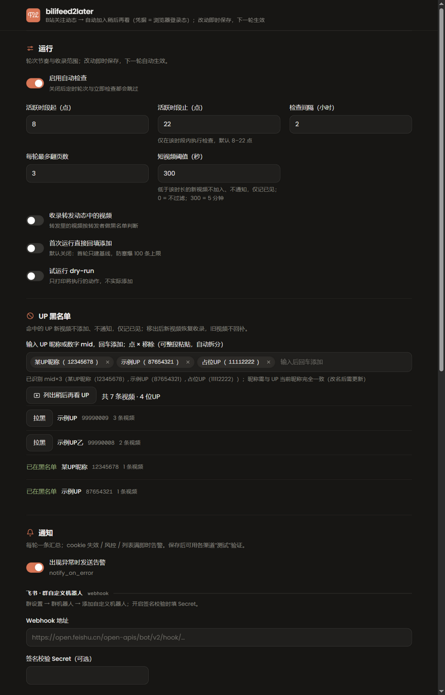
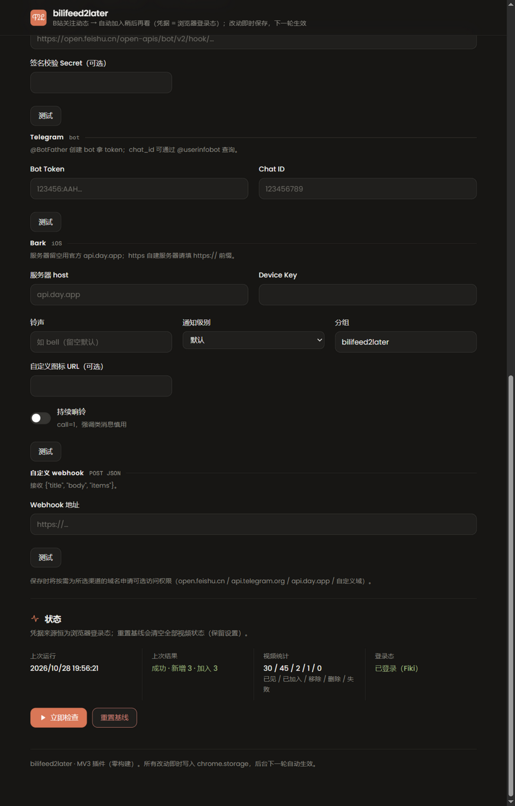
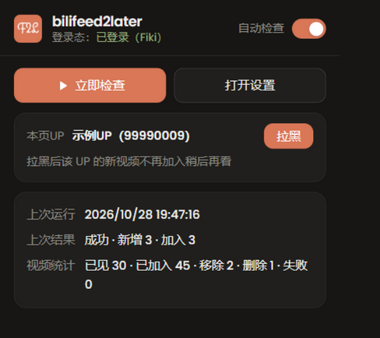

# bili-feed2later-extension

非官方浏览器插件（Chrome / Edge MV3）：定时检查哔哩哔哩关注 UP 的新视频，自动加入「稍后再看」，并推送通知。

把"追更"变成一个被动动作：白天每隔两小时自动看一眼关注动态，有新视频就收进稍后再看，等你有空统一看。已处理过的视频有完整的状态记录——你手动移除的、UP 删掉的，都不会再被重复添加。

- **零构建**：原生 HTML/JS（ES Modules），无框架、无 npm、无打包器。
- **凭据 = 浏览器登录态**：插件不保存任何 Cookie/账密，直接复用浏览器内已登录的 B站会话。
- **状态本机存储**：全部数据保存在 `chrome.storage.local`，不上传任何第三方服务器（通知渠道除外）。
- **快速拉黑**：播放页点开弹窗一键拉黑当前 UP；设置页可列出稍后再看里的全部 UP（按最近加入排序）批量拉黑。
- **MiniMax 风格 + 深浅色自适应**：弹窗与设置页均为 MiniMax 设计规范（与服务端配置页同款），黑白模式跟随系统自动切换（`prefers-color-scheme`）。
- **工具栏弹窗**：点击图标出菜单——快捷开关（自动检查启停 + OFF 角标）、立即检查（后台执行）、状态信息、播放页专属「本页UP」快速拉黑、打开设置。

## 预览







## 安装（开发者模式加载）

1. 打开扩展管理页：
   - Chrome：地址栏输入 `chrome://extensions`
   - Edge：地址栏输入 `edge://extensions`
2. 打开页面上的 **开发者模式** 开关。
3. 点击 **加载已解压的扩展程序**，选择解压出的目录（或本仓库目录）。
4. 建议把图标固定到工具栏；**点击图标弹出菜单**：顶部**「自动检查」快捷开关**（随手启停，停用时图标显示灰色 `OFF` 角标）、**立即检查**（手动触发一轮，在后台执行，弹窗关闭不打断）、**状态信息**（上次运行/结果、视频统计、登录态），以及“打开设置”入口（也可右键图标 → “选项”）。在 B站播放页打开弹窗时，额外出现**「本页UP」快速拉黑**：自动识别当前稿件 UP，点“拉黑”即加入黑名单（已在黑名单则显示绿色标记）。

## 开始使用

1. **先在浏览器里登录 B站**（bilibili.com）。未登录时插件会在 badge 显示 `!`，并（若配置了通知）发送告警。
2. 打开设置页，按需调整“运行”分区里的选项（默认：8–22 点、每 2 小时一轮，可直接用）。
3. 首次运行只 **建立基线**：把当前时间线里的视频全部记为“已见”，不回填添加（可在设置里改为首次直接回填）。
4. 之后无人值守：每轮检查关注动态，发现新视频 → 自动加入稍后再看 → 发送汇总通知。
5. 浏览器关闭期间错过的轮次，会在下次启动浏览器时（若已超期且在活跃时段内）**补跑一次**。

## 设置项说明（“运行”分区）

| 设置 | 说明 |
|---|---|
| 启用自动检查 | 总开关，关闭后闹钟仍在但每轮直接跳过 |
| 活跃时段 | 本地时间 `[起, 止)`，默认 8–22 点；时段外不执行 |
| 检查间隔 | 小时数，默认 2 |
| 收录转发动态中的视频 | 默认关（只收原创投稿 DYNAMIC_TYPE_AV） |
| 首次运行直接回填添加 | 默认关（首跑只建基线不回填） |
| 试运行 dry-run | 只在控制台打印将执行的动作，不调用添加接口 |
| 每轮最多翻页数 | 默认 3 页，遇到已入库的动态会提前收敛 |
| 短视频阈值 | 秒数，默认 300（5 分钟）：时长低于阈值的新视频不添加、不通知，仅记“已见”（与黑名单一致，旧视频不回补）；`0` = 不过滤；时长未知（解析失败）的视频照常加入 |
| UP 黑名单 | 标签式输入：UP 昵称、数字 mid（space.bilibili.com 链接自动提取数字）。条目统一以 昵称（mid） 复合格式存储（按 mid 匹配、自描述）：拉黑直接写该格式；手动添加昵称自动经搜索/关注列表解析 mid 升级；存量条目打开设置页时自动升级；自动解析失败会打开B站用户搜索页辅助确认，回车输入数字 mid 即可。名单内 UP 的新视频不添加、不通知，仅记“已见”；移出后新视频恢复收录，旧视频不回补 |
| 快速拉黑 | 黑名单区「列出稍后再看 UP」：拉取当前稍后再看列表，按最近加入时间倒序列出全部 UP，点“拉黑”把 mid 写入黑名单（即时保存生效）；已在黑名单的显示绿色标记。播放页弹窗的「本页UP」同样一键拉黑，支持普通播放页（/video/BV…）与稍后再看等列表播放页（/list/watchlater/?bvid=BV…） |

## 通知渠道（“通知”分区）

- **飞书**：群机器人 webhook（完整 URL 或 hook token）；机器人开启“签名校验”时必须填 secret。
- **Telegram**：`@BotFather` 创建 bot 拿 token；chat_id 可通过 `@userinfobot` 查询。
- **Bark**（iOS）：填 device key；服务器留空用官方 `api.day.app`。支持可选参数：
  - **铃声**（`sound`，如 `bell`）、**级别**（`level`：`active`/`timeSensitive`/`passive`）、
    **分组**（`group`，默认 `bilifeed2later`，App 历史按此归组）、**图标 URL**（`icon`）、
    **持续响铃**（`call=1`，慎用）——全部有值才携带。
- **自定义 webhook**：向填入的 URL POST JSON `{title, body, items}`。

每个渠道都有“测试”按钮。保存时插件会按需为所选渠道的域名申请可选访问权限
（`open.feishu.cn` / `api.telegram.org` / `api.day.app` / 自定义域），拒绝后可点“测试”重新授权。

汇总通知格式（纯文本）：

```
🎬 bilifeed2later · 10-23 14:00
新增 3 条稍后再看：
1.【UP名】视频标题（12:34）
   https://www.bilibili.com/video/BVxxxx
```

## 状态说明（“状态”分区）

- **上次运行 / 上次结果**：最近一轮的时间与摘要。
- **凭据来源**：恒为“浏览器登录态”；未登录时会红字提示去登录 B站。
- **视频状态统计**：
  - `已见 (seen)`：已见过但未加入（基线、黑名单、短视频阈值、列表满后的剩余等）
  - `已加入 (added)`：已在稍后再看列表
  - `手动移除 (user_removed)`：对账发现被你从列表移除，**终态，永不再添加**
  - `稿件已删 (api_deleted)`：UP 删除了稿件（接口返回 90003），终态
  - `添加失败 (add_failed)`：临时失败，连续 3 轮内自动重试，超过后不再重试
- **立即检查**：手动触发一轮。
- **重置基线**：清空全部视频状态（保留设置），下一轮重新建立基线。

## 限额与幂等

- 稍后再看列表上限 100 条：加满（90001）时中断本轮、剩余记“已见”，并发告警提醒手动清理；插件不会自动清理列表。
- 已加入过的视频 / 终态视频永不重复调用添加接口；手动移除的视频对账后也不会再加回。

## 目录结构

```
.（本仓库根目录）
├── manifest.json        # MV3 清单（alarms/storage/cookies + bilibili 域权限 + popup）
├── background.js        # Service Worker：闹钟调度、补跑、popup“立即检查”消息处理
├── action_popup.html/js # 工具栏弹窗（立即检查 / 本页UP快速拉黑 / 状态 / 打开设置；MiniMax 风格，深浅色随系统）
├── icons/               # F2L logo 图标（128/48 为 Grand Hotel 手写体，32/16 换思源黑体 Bold 保证小尺寸辨识）
├── options.html/js      # 设置页（运行 / UP黑名单 / 通知 / 状态；MiniMax 风格，深浅色随系统）
├── lib/
│   ├── api.js           # B站接口薄客户端（nav / feed/all / toview，credentials: include）
│   ├── store.js         # chrome.storage.local 状态（videos / kv / settings）
│   ├── notify.js        # 飞书(含签名)/TG/Bark(含参数)/自定义 webhook sender
│   └── pipeline.js      # 核心流水线（登录校验→基线→拉取→添加→对账→通知）
└── README.md
```

## 隐私与合规

个人自用：仅访问你本人账号的数据，低频请求（默认每天 ≤ 8 轮）；不上架商店、不公开分发。
B站接口参数为本项目自有实现，请遵守目标网站的服务条款。
